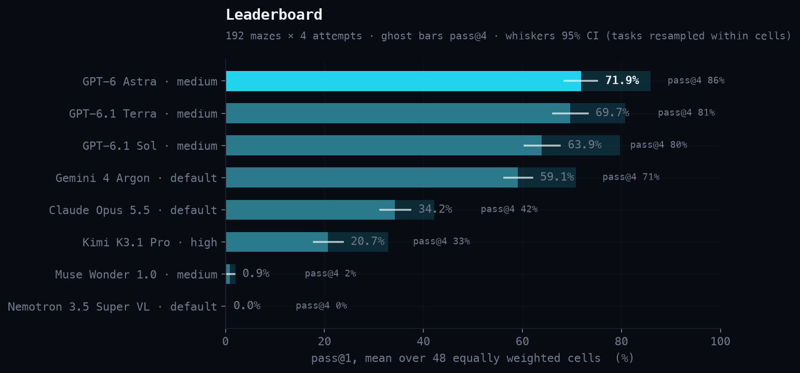
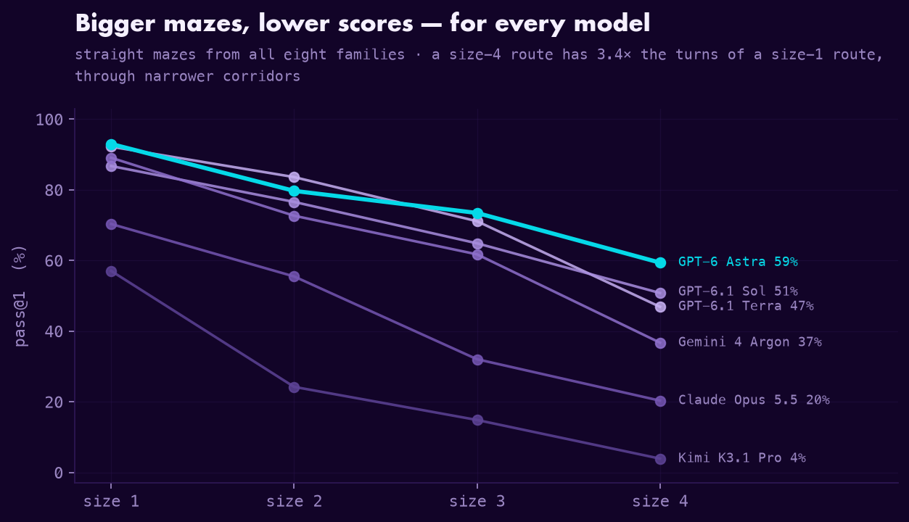
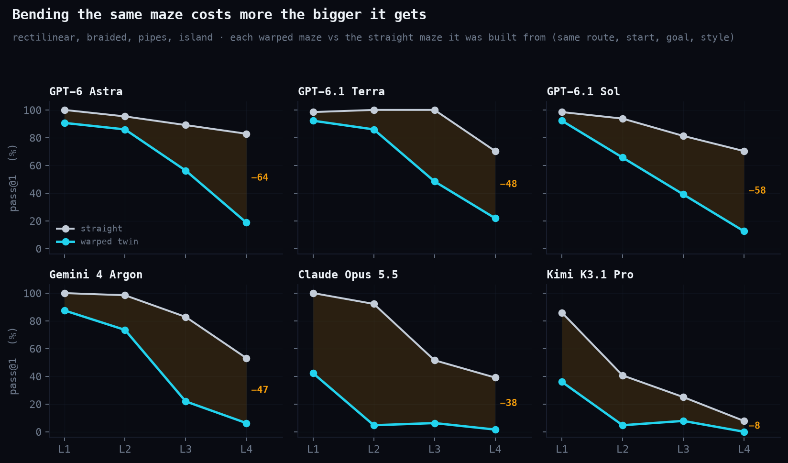
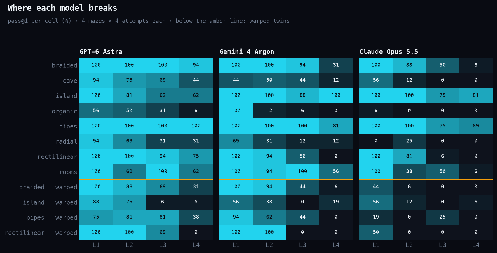
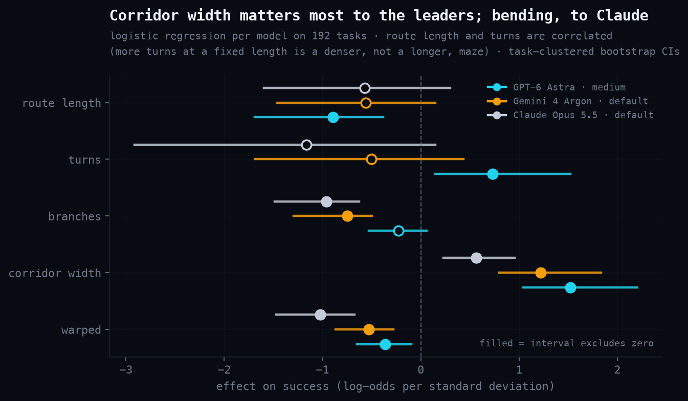
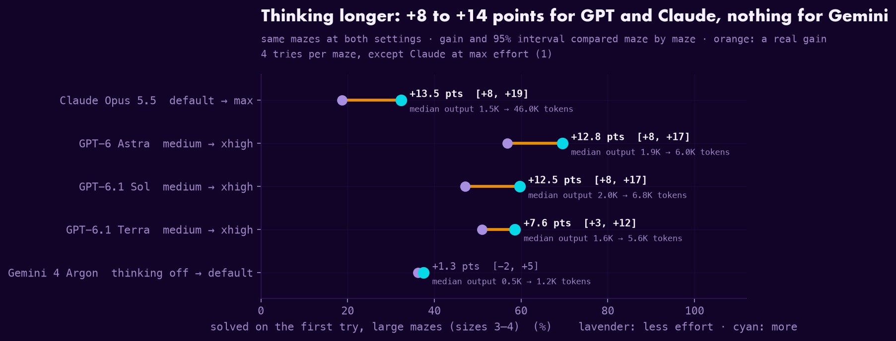
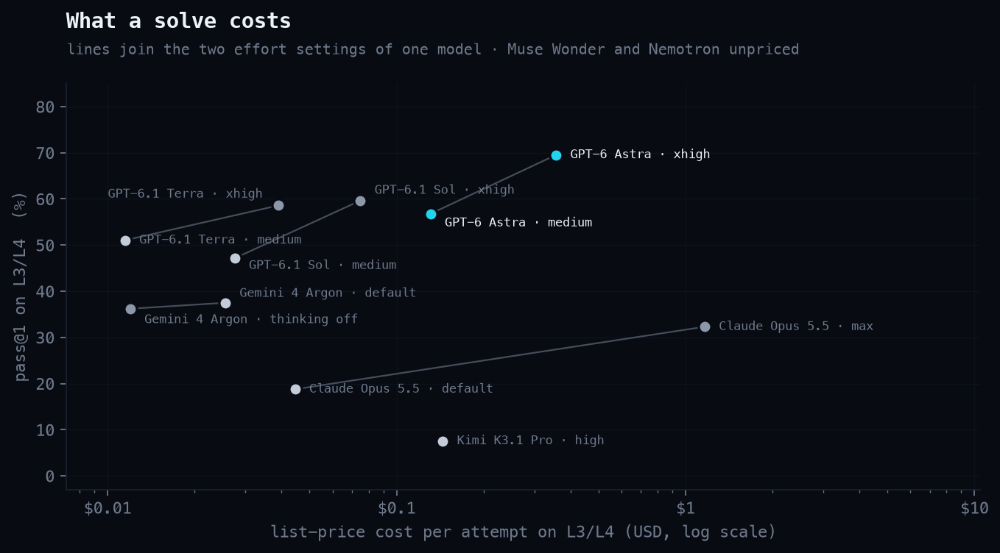
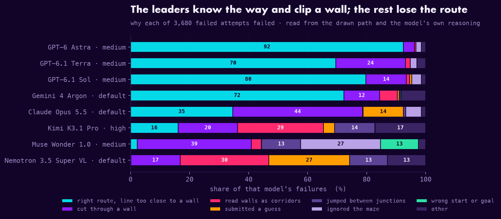
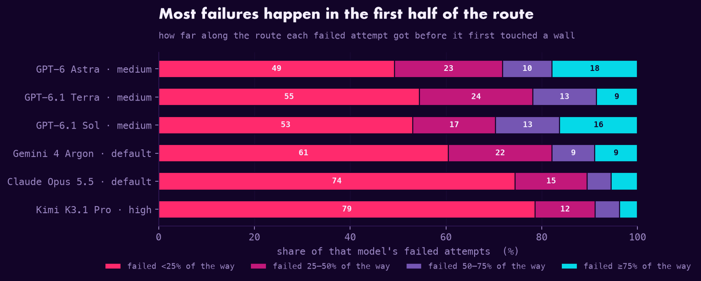
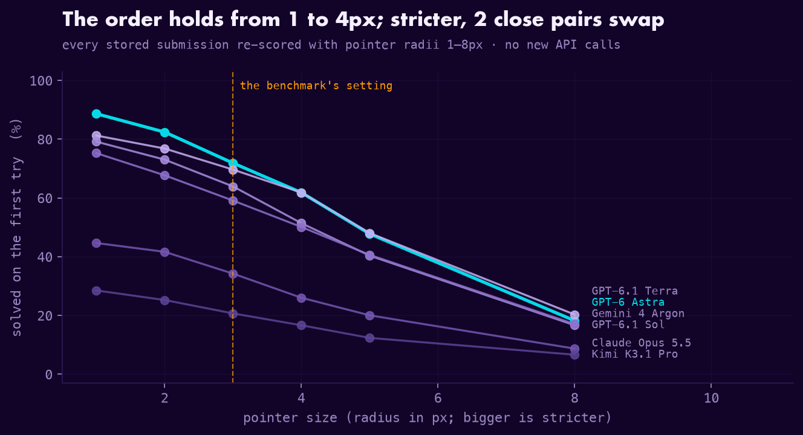

# MazeRunner: the study

**Can an AI draw its way out of a maze? Eight models, 192 mazes, and what they
showed.**

A model gets one picture of a maze and must draw one continuous stroke from the
cyan start badge to the amber goal badge, as a list of points in a single tool
call. We sweep a pointer 3 pixels in radius along that line, against the same
mask the picture was painted from. If it touches a wall anywhere, or doesn't
start on the start badge and end on the goal, the try fails. There is no grid,
no list of moves to choose from, and no partial credit for a plan that reads
well.

The mazes come in eight layouts at four sizes, and the four grid layouts also
come bent: 192 mazes in 48 equally weighted groups of four. The best model,
GPT-6 Astra at medium effort, solves 71.9% on the first try. On the largest
bent mazes no model passes 30%, at any effort setting.



---

## 1. What makes a maze hard

Solving a maze is easy for these models. Drawing the solution is not. Rather
than hand-pick hard mazes, the set turns the generator settings that make a
maze hard into two dials:

- **Size.** Four sizes per layout. Each size up adds rows and columns (or
  rings, rooms, islands) and narrows the corridors. A size-4 route has 3.4×
  the turns of a size-1 route and 2.3× the branch points.
- **Bending.** The four grid layouts (rectilinear, braided, pipes, island) also
  come bent at every size: the same maze drawn on a smoothly warped grid. A
  bent maze is built from the same generation step as its straight twin, so
  the layout, route, start, goal and visual style are identical and only the
  geometry changes. 64 bent/straight pairs in all.

Every group of four mazes counts equally in the score, so no layout or size
dominates it.

| Layout | What it is |
|---|---|
| rectilinear | a classic grid maze with exactly one route |
| braided | a grid maze with extra loops, so more than one route reaches the goal |
| pipes | a sparse network of straight pipes on a coarse grid, with loops |
| island | scattered islands joined by paths, with loops |
| rooms | a grid of rooms joined by corridors |
| cave | irregular cave passages |
| radial | rings joined by spokes around a centre |
| organic | curved corridors between scattered points |

Layout is separate from look: each maze is drawn in one of 14 visual styles.

---

## 2. How the mazes are built, and why you can trust the scores

The generator makes four things per maze from one seed: the maze itself, a
solver's route, an open-space mask, and the picture. **The picture is painted
through the mask like a stencil**, so anything that looks open is open: a model
is never penalised for trusting what it sees.

Every maze must also pass a pixel-level **fairness check** before it ships:
corridor edges legible all the way around, no corridor-coloured area outside
the mask, decoration inside a corridor never wider than a third of it, and
enough contrast at both badges. The check fails closed: a style is resampled up
to six times, and a maze that still fails is dropped, with every rejection
logged.

A few construction details matter for fairness:

- **Bent twins keep their route.** The grid generators bend the maze after
  choosing the endpoints, so a bent maze has the same route as its straight
  twin.
- **No stray specks.** Drawing the mask can leave isolated wall specks of 1–6
  px at corridor joins. Enclosed specks of 12 px or less are filled (the
  smallest real wall is 116 px).
- **Seamless caves.** Cave cells are drawn so that scaling never opens
  hairline seams between them, which would otherwise show as dashed lines and
  act as walls.
- **Every maze is drawable within the limits.** The stored reference route is
  the fewest-point version that still passes the scorer, under the 512-point
  cap on a submission. The longest needs 349 points.

The start and goal are drawn from the same far-apart band at every size, and
no straight maze repeats the layout of one already published (checked by
graph hash). `mazerunner dataset verify --full`
rebuilds every maze from its recorded settings and demands byte-identical
masks.

**Dataset:** `datasets/v2/test`, 192 mazes, 14 visual styles, all public.

---

## 3. How the models were run

Every model got the same prompt and the same tool. The prompt doesn't give the
image's size in pixels or the pointer's size; reading those from the picture is
part of the task.

```
You are looking at a maze rendered as an image. Somewhere in the maze is a START
marker drawn as a cyan circular badge with a white play arrow, and a GOAL marker
drawn as an amber circular badge containing a small treasure chest.

Trace one continuous drag path from the start marker to the goal marker:
- Begin at the cyan badge and end at the amber badge.
- Stay on the traversable route and follow the center of the corridor.
- Never cross walls or leave the open route.
- Consecutive points are joined by straight segments, so add enough points that
  every bend and curve of the route is followed.

Coordinates are normalized to the image: (0,0) is the top-left corner, (1,1) is
the bottom-right corner.

Answer only by calling the submit_drag_path tool exactly once with your full
trajectory. Do not answer in prose.
```

The tool, `submit_drag_path`, takes 2 to 512 `{x, y}` points between 0 and 1.

| | |
|---|---|
| Mazes | all 192 in `datasets/v2/test` |
| Tries | every model at its default or standard setting × every maze × 4 tries; the extra-effort settings ran the 96 large mazes (sizes 3 and 4) |
| Order | shuffled per model setting, order seed 20261028 |
| Settings | `configs/providers.v2.json` |
| Time limit | 10 minutes per call; 30 minutes for GPT at xhigh and Claude at max |
| Run | 29 October to 2 November 2026, 7,776 tries |

**The score.** **pass@1** is the share of mazes solved on a single try: each
maze's pass rate, averaged within its group of four, then averaged over the 48
groups. **pass@4** is the share solved in at least one of four tries. The
extra-effort settings are scored on the 24 large-maze groups and shown in their
own table, never ranked against full scores. Route progress, how much of the
route a failed try covered before it touched a wall, is reported beside pass@1
and never mixed into it.

**The ranges.** 95% confidence intervals come from resampling the mazes within
each group. Four tries at one maze are not four independent observations;
resampling tries instead would shrink the intervals by about half and make
differences look surer than they are. Two settings of one model are compared
maze by maze, so the difficulty of each maze cancels out.

**Tries that never came back.** A call can fail in transit (a dropped
connection) or reach the model and not finish in time. Connection errors never
reached the model, so they were retried until they got an answer. A try where
the model was asked twice and answered neither time counts as a **fail**: 32 of
7,776 tries, 17 GPT-6 Astra xhigh, 12 GPT-6.1 Sol xhigh and 3 GPT-6 Astra
medium, all on the longest routes. No try is missing from the results.

---

## 4. The leaderboard

| | Model | pass@1 [95% CI] | Small (1–2) | Large (3–4) | Large grids, straight → bent | pass@4 | Route progress |
|---|---|---|---|---|---|---|---|
| 1 | GPT-6 Astra · medium | **71.9%** [68.5, 75.1] | 86 | 66 | 86 → 38 | 86% | 81.8% |
| 2 | GPT-6.1 Terra · medium | **69.7%** [66.1, 73.2] | 88 | 59 | 85 → 35 | 81% | 78.3% |
| 3 | GPT-6.1 Sol · medium | **63.9%** [60.4, 67.6] | 82 | 58 | 76 → 26 | 80% | 75.7% |
| 4 | Gemini 4 Argon · default | **59.1%** [56.4, 62.0] | 81 | 49 | 68 → 14 | 71% | 69.2% |
| 5 | Claude Opus 5.5 · default | **34.2%** [31.2, 37.4] | 63 | 26 | 45 → 4 | 42% | 46.1% |
| 6 | Kimi K3.1 Pro · high | **20.7%** [17.8, 23.7] | 41 | 9 | 16 → 4 | 33% | 32.1% |
| 7 | Muse Wonder 1.0 · medium | **0.9%** [0.1, 1.8] | 3 | 0 | 0 → 0 | 2% | 8.0% |
| 8 | Nemotron 3.5 Super VL · default | **0.0%** [0.0, 0.0] | 0 | 0 | 0 → 0 | 0% | 4.1% |

The size columns are pass@1 too. Small is sizes 1–2 and large is sizes 3–4,
across all layouts; the last size columns compare the four grid layouts at
sizes 3–4 with their bent twins. Astra and Terra are within each other's
ranges, as are Sol and Argon, so the board does not claim an order within
either pair.



Every model falls at every size step. By size 4 the GPT-6 models have lost
37–49% of their size-1 score and Gemini 4 Argon 58%; Claude Opus 5.5 and Kimi
K3.1 Pro lose 71% and 93%.

---

## 5. Bigger is harder. Bent is much harder.



Are irregular mazes hard because of their shapes, or because irregular layouts
also happen to have different routes? The bent twins answer that: the route is
held fixed and only the geometry bends.

- For the leaders, bending costs more the bigger the maze. GPT-6 Astra loses 9
  points at size 1 and 64 at size 4 (83% → 19%). A small bent maze is still
  easy; a large one is where they lose the route.
- For Claude Opus 5.5 the bending itself is the problem: it solves every
  straight size-1 grid and 42% of their bent twins, and from size 2 up it
  solves almost no bent maze.



Layouts are not equally hard, and not hard for the same models. Organic mazes
stop Claude from size 1 and Gemini from size 2, while island and pipes stay
solvable for all three models shown. The leader's weakest groups are the bent
size-4 grids and the irregular layouts (organic, radial, cave) at size 4.

### What predicts a failure



A logistic regression of success on each maze's features, per model, with
intervals from resampling mazes. Route length and turn count go together; with
length held fixed, more turns means a denser maze rather than a longer one,
which is why turns can come out positive.

- For GPT-6 Astra and Gemini 4 Argon, **corridor width** is the largest effect
  (+1.5 and +1.2 log-odds per standard deviation): they fail at drawing, with a
  line run too close to an edge.
- For Claude Opus 5.5, **bending** (−1.0) and **branching** (−1.0) dominate:
  it loses the route itself.
- Bending hurts all three even with length, turns, branches and width held
  fixed.

---

## 6. Thinking longer helps some models, at a price



Four models also ran at a second effort setting on the large mazes, and each
was compared maze by maze with its normal setting.

| Model | Setting | Large-maze pass@1 | Gain [95% CI] | Median output |
|---|---|---|---|---|
| Claude Opus 5.5 | default → max | 18.8% → 32.3% | **+13.5** [+7.8, +19.3] | 1.5K → 46K tokens |
| GPT-6 Astra | medium → xhigh | 56.8% → 69.5% | **+12.8** [+8.1, +17.4] | 2.0K → 6.0K |
| GPT-6.1 Sol | medium → xhigh | 47.1% → 59.6% | **+12.5** [+8.3, +16.7] | 2.0K → 6.8K |
| GPT-6.1 Terra | medium → xhigh | 51.0% → 58.6% | **+7.6** [+2.9, +12.2] | 1.6K → 5.6K |
| Gemini 4 Argon | thinking off → default | 36.2% → 37.5% | +1.3 [−2.3, +5.2] | 0.5K → 1.2K |

- GPT-6 at xhigh and Claude at max effort gain 8 to 14 points. The gain is on
  the straight mazes: the largest bent mazes stay at or below 28% for every
  setting.
- At its default (adaptive thinking), Claude Opus 5.5 writes under 350 tokens
  of reasoning per call. At max it writes 30× as much and costs 26× as much per
  try, for less than twice the score. It ran one try per maze (96 calls), so
  its range is wider.
- Gemini 4 Argon decides for itself, call by call, whether to think (it did on
  55% of calls). Its higher settings had no effect through the gateway it was
  served on, so the comparison runs the other way: switching thinking off costs
  1.3 points, within the noise, at half the price.



At list prices, GPT-6.1 Terra at medium is the cheapest strong setting ($0.011
per large-maze try for 51%), and GPT-6 Astra at xhigh the most accurate ($0.36
for 70%). Muse Wonder 1.0 and Nemotron 3.5 Super VL had no published price on
the route used and are left off.

---

## 7. The best models know the way. Their hand isn't steady enough.



We sorted every failed try by what went wrong, from the drawn path and, where
the model shared it, its reasoning. A reasoning-based label is given only when
the path agrees with it. The full list of failure types, each model's shares,
and the two rules adjusted after spot checks are in
[results/failure-modes.md](results/failure-modes.md).

- Nine in ten of GPT-6 Astra's failures follow a route that stays inside the
  corridor and still clip a wall with the 3px pointer. Most GPT-6 and Gemini
  tries return no reasoning summary, so for them these labels come from the
  path alone.
- Claude Opus 5.5 cuts across walls (44% of its failures), and in 14% says it
  will commit to a best-guess path it could not check.
- Kimi K3.1 Pro and Nemotron 3.5 Super VL most often mistake the walls for the
  corridors, and their reasoning says so.



Mistakes come early, not at the finish line. Even for the leader, 72% of
failed tries first touch a wall in the first half of the route; for Claude and
Kimi it is 90% and 91%.

---

## 8. Does the 3-pixel pointer decide the ranking?



Every score depends on one number, the pointer's 3-pixel radius. We re-scored
every stored try with pointers from 1 to 8 pixels (no new calls). Every score
moves, but the order of the six models with real scores holds from 1 to 4
pixels. From 5 pixels up, two pairs trade places, Astra and Terra, and Sol and
Argon, and both pairs are already within each other's ranges at 3 pixels.

---

## 9. Decisions made during the run, and other fine print

The design (groups, sizes, bending, equal weights, extra effort on the large
mazes only) was fixed before the main run. Decisions made after it started, in
order:

- **27 October: setting the sizes.** The generator settings for each size were
  chosen by running GPT-6.1 Terra at medium and Gemini 4 Argon on 159 candidate
  mazes, then a pilot with those two and GPT-6 Astra at xhigh, aiming for
  scores that fall steadily with size rather than for a target score. Settings
  were chosen per size, never maze by maze. Even so, three of the settings on
  the board informed the design.
- **29–31 October: outages.** Overnight network loss turned about 750 calls
  into connection errors, and Kimi K3.1 Pro's only host returned rate limits
  for hours. Every affected call was retried; none had reached the model, so
  the retries are first tries.
- **31 October: the no-answer rule** (§3), decided while the extra-effort
  settings were still running and before any final score was computed.
- **2 November: gateway resets count as tries.** Three tries had one client
  timeout and one gateway reset of a long request. Both reached the model, so
  both count, and the three score as fails.
- **2 November: two more effort comparisons.** Claude Opus 5.5 at max (one try
  per maze) and Gemini 4 Argon with thinking off were added after the GPT
  effort results were in, so that more than one vendor has an effort
  comparison.
- **2 November: two failure-sorting rules** were adjusted after spot checks
  ([details](results/failure-modes.md#two-rules-adjusted-after-spot-checks)).

Other fine print:

- Serving: the OpenAI, Google, Anthropic and Meta models ran through a
  LiteLLM gateway; Kimi K3.1 Pro (Moonshot) and Nemotron 3.5 Super VL (Crusoe,
  bf16) through OpenRouter, each pinned to one host. A different host may score
  differently.
- Four mazes per group is a small sample. Numbers for a single group (§5) have
  wide ranges; the headline averages 48 of them.
- There is no hidden test set. Please don't train on these mazes.

---

## 10. Reproducing the numbers

Every number in this document, on the site and in the figures is computed from
the merged run and the offline analyses; nothing is typed by hand.

| | |
|---|---|
| Full traces | release asset `mazerunner-v2-traces.tar.gz`: all 7,776 tries with reasoning, raw responses, token usage and settings, plus the board and analyses |
| Board | `results/analysis/board.json` (`mazerunner board --out`) |
| Analyses | `results/analysis/`: failure labels, pointer-size re-scoring, figure findings |
| Settings | `configs/providers.v2.json`, `configs/board.v2.json` |

### Commands

```bash
uv run mazerunner dataset verify --full                # rebuild all 192 mazes from their settings
uv run mazerunner run --config configs/providers.v2.json --providers gpt6-astra \
    --dataset datasets/v2/test --trials 4 --run-id v2-main-gpt6-astra \
    --order-seed 20261028 --resume --resume-max-timeouts 2
uv run mazerunner merge --runs 'results/v2-main-*/shard-*' --out results/v2/final
uv run mazerunner board --out results/analysis/board.json
uv run mazerunner failuremodes                         # results/analysis/failure-modes.jsonl
uv run python scripts/make_figures.py                  # figures + findings
uv run python scripts/build_site.py                    # landing page data
```

To score from the release traces instead of re-running, extract the tarball
to `results/v2/final/` and start from `mazerunner board`.
